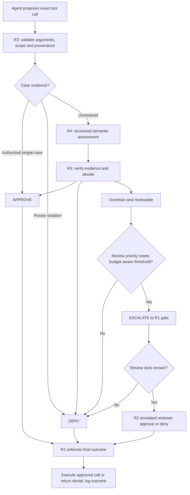

# How major AI companies approve agent actions

Research date: **19 October 2026, Asia/Singapore**. Purpose: inform AI6101 Role 3 (heuristics and budget-aware tool approval). This is a research note, not the five-page assessed report or an implementation.

For policy-type classifications, public policy files, unknown training details and a proposed component architecture, see [Policy types and proposed architecture](POLICY_TYPES_AND_PROPOSED_ARCHITECTURE.md).

**Project update, 20 October:** The policy targets workspace, travel, banking and Slack; see [multi-domain scope](MULTI_DOMAIN_POLICY_SCOPE.md). The user accepts official AgentDojo outcomes plus executed-call audit trails; use [the evaluation contract](README.md#evaluation-contract) for the scoring contract. Industry architectures remain inspirations, not evidence of our policy’s improvement. Domain examples below illustrate shared checks; actual semantics must be supplied per suite.

## 1. What was verified

This review searched and opened primary documentation, company engineering reports, research papers, and an official research repository. “Verified” means the linked source was retrieved and supports the stated claim; it does **not** mean the product was independently tested, its private implementation audited, or its safety guarantees reproduced. Live documentation can change without a versioned publication. Product availability can depend on client, version, account, organization policy, and configuration.

Labels used below:

- **Documented:** a capability or behavior described by its provider.
- **Company-reported:** an engineering measurement or evaluation reported by the company, not reproduced here.
- **Research:** a paper/prototype, with its own assumptions and experimental conditions.
- **Inference/proposal:** our interpretation or recommendation for this course project.

All sources in the reference list were opened during this research. Product instructions encountered in sources were treated as evidence; no configurations, permissions, accounts, or API calls were changed. References are linked beside claims and indexed at the end.

## 2. Main answer

**Synthesis/inference:** The reviewed systems combine several controls: configured rules, restricted execution environments, model-based checks, human approval, and review of resulting changes. An action being possible inside a sandbox does not establish that the user authorized it. A model judging an action acceptable does not establish that execution constraints are correctly enforced.

The closest publicly documented parallels to our hybrid design are Claude Code's rule/classifier layers, VS Code's experimental Assisted permissions, and Codex's approval-request reviewer. Gemini CLI explicitly exposes three policy outcomes. These are parallels, not proof that our policy reproduces their implementations. [S01][s01] [S03][s03] [S06][s06] [S10][s10]

**Evidence gap:** In the sources reviewed, I did not find a documented product mechanism that optimizes a fixed per-task allowance of exactly $k$ human reviews using a threshold such as $\tau(b)=\tau_{\mathrm{base}}+\delta/b$. This is a bounded literature-search finding, not proof that no company uses budget allocation internally or that our idea is novel.

## 3. Distinguish the mechanisms before comparing them

These definitions are an analytical framework for this report, not a claim that every provider uses the same terminology.

| Mechanism | Question it addresses | What it does not establish by itself |
| --- | --- | --- |
| Permission rule | Is this tool/argument/path allowed by configuration? | Whether the action fits this particular user request |
| Authorization assessment | Does the operation, target, recipient and data match user intent? | That the assessment is correct |
| Sandbox | What can this process access or change? | Whether an allowed operation is wanted |
| Input defense | Is external content trying to redirect the agent? | Whether the next action is authorized |
| Human confirmation | Does a person approve this concrete request? | That the person understood it or reviewed carefully |
| Output/PR review | Should the resulting changes be accepted? | That no earlier read, disclosure or side effect occurred |
| Budget allocation | Which uncertain calls should receive scarce review? | That the reviewer will resolve uncertainty correctly |

A project gate should enforce the final decision immediately before each tool execution. The semantic policy and enforcement mechanism should remain independently inspectable. This is our design recommendation.

## 4. GitHub Copilot and Microsoft

### 4.1 Copilot cloud agent: constrain the environment and integration path

**Documented:** GitHub describes repository-scoped access, branch restrictions that prevent direct pushes to the default branch, approval before agent-triggered pull-request workflows run, and a default firewall against data exfiltration. The agent does not receive ordinary repository/organization Actions secrets; explicitly supplied Copilot-environment secrets are a separate case. These are cloud-agent controls, not a universal specification for every Copilot client. [S02][s02]

**Inference:** This illustrates reducing blast radius and requiring review at integration boundaries. A pull request is not equivalent to approving every preceding tool call. Our benchmark must still count unauthorized actions that happened before the final output.

### 4.2 VS Code: rules, optional model-assisted approval, and separate sandboxing

**Documented:** The VS Code security page describes configurable terminal-command approval, including checking all subcommands in compound commands. Its **experimental Assisted permissions** mode uses an LLM judge and asks the user when the judge does not approve. It separately documents OS-level agent sandboxing and warns that outbound networking remains enabled by default unless configured otherwise. Scope depends on the session/harness. [S01][s01]

**Inference:** This is a close reference for rules plus an LLM assessment, but does not establish our judge schema, risk thresholds, calibration, or finite-review allocation. Nor does enabling a sandbox necessarily block outbound disclosure.

### 4.3 Microsoft research: Spotlighting

**Research:** Hines et al., *Defending Against Indirect Prompt Injection Attacks With Spotlighting* (2024), transform untrusted inputs to make provenance more apparent to the model. The paper discusses delimiting, datamarking, and encoding. Its reported attack-success reduction is tied to its experiments, not a general guarantee for tools or Copilot deployments. [S12][s12] [S13][s13]

**Documented company position:** Microsoft's security discussion describes indirect-injection defense as a layered problem, including techniques that help distinguish external data from instructions. It does not establish that every Copilot action follows one shared approval algorithm. [S14][s14]

**Inference:** Marking evidence provenance can help the judge, but text labels cannot replace code-level authorization checks.

## 5. OpenAI

### 5.1 Codex: sandbox and approval policy are separate controls

**Documented:** Codex documentation distinguishes sandbox restrictions from approval routing. It documents an automatic reviewer for eligible requests, an authorization/risk policy, and fail-closed handling for review/parse failures; timeouts also leave the action unexecuted. Routine actions already permitted within the sandbox do not necessarily invoke the reviewer. [S04][s04]

**Inference:** Our policy should record both why a call needs review and whether it was actually executed. “Automatically reviewed” must not be used to describe every action in a Codex session.

### 5.2 Codex Auto-review: a separate reviewer at an approval boundary

**Documented:** Auto-review replaces the human reviewer for eligible interactive approval requests while preserving the main agent's sandbox configuration. Examples include sandbox escalations, restricted network requests and edits outside writable roots. It is not itself a blanket permission grant. Computer Use application approvals remain a separate case. [S03][s03]

**Inference:** This resembles R1 plus a separate reviewer, but the course's simulated-human reviewer is a specified experimental component. We should not equate it with Codex's private model, prompts, or coverage.

### 5.3 Agents SDK: pause before execution, then resume

**Documented SDK pattern:** A function tool can declare `needs_approval=True`. The run returns approval interruptions and resumable state rather than executing the pending tool. The application approves or rejects and resumes that state. The documentation also distinguishes tool-level checks from relying only on agent input/output guardrails. [S05][s05]

**Inference:** A refusal written in the agent's final answer is too late if the tool already executed. Our gate must intercept the call, not merely inspect the completed conversation.

### 5.4 Computer-use guidance: evidence is not permission

**Documented integration guidance:** OpenAI distinguishes direct user intent from third-party content such as PDFs, emails, webpages, and tool outputs. It recommends confirmations for sensitive transmissions that identify the data, recipient and purpose, and notes that typing sensitive information into a form can itself transmit it. These are integration recommendations, not evidence that every application implements them. [S07][s07]

**Inference:** Scope checks must include data content and destination, not just a send/submit button. Finding a recipient in a document does not independently authorize disclosure.

### 5.5 A relevant documentation caveat

The retrieved Agent Builder safety guide recommends MCP approvals, including reads and writes, and marks Agent Builder as being deprecated. Treat this as guidance for that documented framework, not a universal claim that every OpenAI product requests confirmation for every read. [S08][s08]

## 6. Anthropic / Claude Code

### 6.1 Auto mode: a close match to a hybrid approval architecture

**Company engineering description, published 25 March 2026:** Claude Code Auto mode combines early tool/user-rule allowances and in-project edits with a later transcript classifier. Its classifier uses a fast screening stage and deeper reasoning for flagged cases. The article describes an input-side injection probe and an output-side action check; the classifier context excludes assistant prose and tool outputs. It reports that users approve 93% of permission prompts, which is an approval rate—not evidence that all those approvals were blind. Model names and deployment details in that dated article are historical. [S06][s06]

**Inference:** Separate cheap filtering, semantic assessment and final enforcement. Reviewer context selection is a security/accuracy trade-off: excluding material reduces an injection channel but can remove evidence needed to judge authorization.

### 6.2 Current permission modes and failure behavior

**Documented:** Claude Code exposes permission modes including `auto`, `dontAsk`, and `bypassPermissions`. `dontAsk` denies calls that would otherwise prompt, while actions needing no approval can still run. The current mode documentation describes denial when a server review returns no usable verdict, and default blocking categories such as sensitive external transmission and production changes. Behavior is subject to settings and explicit permissions. [S09][s09] [S11][s11]

**Inference:** Judge failure and clear violation should be different logged reasons, even when both prevent execution. Denying all unresolved calls is a meaningful comparator, but a model-based approval system is not automatically equivalent to a human escalation.

### 6.3 Sandboxing reduces the number of decisions people must make

**Company-reported, published 20 October 2025:** Anthropic reported an 84% reduction in permission prompts in internal use after sandboxing. The described mechanism combines filesystem and network isolation, including restrictions inherited by child processes. This is not an 84% increase in safety, an attack-success reduction, or a measurement from our project. [S15][s15]

**Documented:** The sandbox configuration has its own boundaries and exceptions; it should be evaluated separately from permission modes. [S16][s16]

**Inference:** Reducing interruption is valuable, but our experiments must establish safe completion rather than treating fewer prompts as success.

## 7. Google: Gemini CLI, Chrome, and CaMeL

### 7.1 Gemini CLI: an explicit three-way rule engine

**Documented:** Gemini CLI policies specify `allow`, `deny`, or `ask_user`. Rules can match tool identity, arguments and mode, with priorities resolving matches. `ask_user` becomes denial in non-interactive operation. The retrieved documentation warns that workspace-tier policies are currently non-functional. Its examples and tier numbering contain inconsistencies, so this report does not recommend copying the numeric tier formula as a verified implementation specification. [S10][s10]

**Inference:** This is a direct reference for our decision enum and inspectable rule configuration. Persistent permissions and rule priorities are different from a per-task escalation budget.

### 7.2 Chrome: action alignment and origin restrictions

**Company architecture description, published 8 December 2025:** Google's User Alignment Critic reviews proposed actions against user intent. It is designed to receive action metadata rather than unfiltered web content, and can veto an action and give replanning feedback. Agent Origin Sets limit relevant cross-origin access; confirmations provide another layer. The article describes a preview-era architecture, not universal availability across all Chrome/Gemini installations. [S17][s17]

**Inference:** Separate the agent's proposed plan from the authority to execute it. Tool-call arguments can still carry attacker-controlled content; reducing reviewer input does not make it infallible.

### 7.3 CaMeL: research with explicit data-flow enforcement

**Research:** *Defeating Prompt Injections by Design*, version 2 dated 24 June 2025, derives control/data flow from trusted requests and uses capability/provenance tracking with an enforcing interpreter. Its abstract reports 77% task completion with its security approach versus 84% for an undefended system in AgentDojo. These are the paper's conditions and metrics, not a product-wide guarantee or directly comparable to our TCR@k. [S18][s18]

**Official artifact qualification:** The Google Research repository explicitly states that this is a research artifact, not a Google product, and warns about bugs and incomplete implementation security. This prevents treating research guarantees as evidence of a production deployment. [S19][s19]

**Inference:** Borrow provenance and recipient/content-scope checks. Do not claim our heuristic policy inherits CaMeL's formal guarantees.

## 8. What recent monitor research warns us about

**Research:** Remedios et al., *Red-Teaming Auto Mode: Improving Blocking Classifiers Against Malign Coding Agents* (September 2026), investigates persistent adversarial agents, including monitor injection, coverage gaps and attacks spanning contexts. It evaluates particular monitor variants; its Guardian baseline is described as an approximation of production behavior. These threat conditions differ from ordinary accidental mistakes and AgentDojo's external injections. [S20][s20]

**Inference:** A judge is another attack surface. Evaluate malicious text inside arguments and reviewer context, and ensure every executable call passes the gate. Do not turn an adversarial study's success rate into a claim about all deployed sessions today.

## 9. Comparison for Role 3

This table summarizes the cited descriptions; it is not a head-to-head security benchmark.

| System/surface | Relevant documented mechanism | Closest project analogy | Important boundary |
| --- | --- | --- | --- |
| Copilot cloud agent [S02][s02] | Repository/branch restrictions, firewall and workflow approvals | Containment and integration controls | Different from per-call authorization |
| VS Code Copilot harness [S01][s01] | Rules and experimental LLM-assisted permissions | Rules plus judge/review | Experimental and client-specific |
| Codex [S03][s03] [S04][s04] | Sandbox plus eligible-request Auto-review | Gate and separate reviewer | Does not review every permitted action |
| Agents SDK [S05][s05] | Tool approval interruption and resume | Enforced escalation lifecycle | Application must supply approval policy |
| Claude Code [S06][s06] | Early allowances and staged classifier | Hybrid decision pipeline | Some actions bypass the classifier |
| Gemini CLI [S10][s10] | Allow/deny/ask rules | Three-way policy contract | No verified finite-k allocator here |
| Chrome agent architecture [S17][s17] | Alignment critic and Origin Sets | Scope-aware assessment | Metadata-only critic has context limits |
| CaMeL [S18][s18] [S19][s19] | Capability/provenance enforcement | Evidence and data-flow checks | Research artifact, not deployed-product proof |

## 10. Recommended design changes for our project

For the detailed internal policy design and justification, see [Scope-aware policy architecture](SCOPE_AWARE_POLICY_ARCHITECTURE.md). The graph below is only the integration overview.

**All items here are proposals/inferences, not claims about company internals.**

### 10.1 Use the industry pattern without claiming to reproduce a product

The graph is our proposed integration, not a diagram of any provider's private system. R1 owns the authoritative budget and actual execution. The R4 judge and R2 reviewer remain distinct roles even though commercial products sometimes use a classifier instead of a person.

### 10.2 What we should implement first

1. **Explicit decision contract:** return decision, reason code, evidence references and layer. Keep intended policy decisions separate from gate overrides.
2. **Narrow heuristic fast path:** approve only verified task-relevant helpers/scoped reads; never approve every read solely by name.
3. **Hard constraints:** reject proven scope/recipient violations before the judge. An unknown or unmatched recipient is uncertainty unless evidence establishes a violation.
4. **Provenance-aware judge context:** preserve direct user intent; label external facts as evidence, not permission. Validate cited evidence references.
5. **Review allocation:** review only when available evidence can resolve uncertainty. Keep approval standards unchanged as budget shrinks.
6. **Enforcement:** check every call, including batch calls, immediately before execution. Denials must prevent side effects and allow valid replanning.
7. **Failure handling:** log malformed outputs, timeouts and missing evidence distinctly. Never turn a judge error into approval.

### 10.3 The budget rule is our experimental component

For uncertain, reviewable calls only, define remaining slots $b$, review priority $p_t$, and a candidate threshold:

$$\tau(b)=\tau_{\mathrm{base}}+\frac{\delta}{b},\qquad b>0,\quad\delta\ge0.$$

Select escalation when $p_t\ge\tau(b)$; otherwise deny with truthful feedback. At $b=0$, R1 denies calls requiring escalation. Review priority is an ordinal heuristic, not a calibrated probability or optimal value of information.

Test against the identical policy with a fixed review threshold. To isolate the *dynamic dependence* on $b$, both variants should receive the same development tuning allowance; a stronger fixed threshold may perform better than simply setting $\delta=0$ while leaving the base threshold unchanged. Report the simple zero-delta ablation if used, but distinguish it from a fairly tuned fixed-threshold competitor. No industry source verifies these numerical settings. Scarcity can lead to unused review slots and blocked progress, so superiority must be measured.

### 10.4 Small, useful validation matrix

| Development case | What to check |
| --- | --- |
| Requested lookup with narrow resource/date scope | Completes without unnecessary judge/reviewer use |
| Unrelated sensitive read | Read-only status does not bypass scope assessment |
| Authorized send with a recipient resolved from task data | No blanket denial merely because the address was absent from the prompt |
| Substituted recipient or extra sensitive attachment | Evidence/target/content checks detect the mismatch |
| Malicious instructions embedded in tool arguments | Judge does not treat them as higher authority |
| Judge timeout or invalid output | No execution from missing approval |
| Two calls with one review slot left | At most one actual escalation; no bypass or ledger duplication |
| Needed uncertain call near exhaustion | Measures the cost of excessive reservation |

Use per-suite development fixtures for integration checks, then online episodes with official AgentDojo evaluators for completion/attack claims. Preserve original/executed calls for audit. Review decisions are not the evaluator truth. Do not require an independently labeled authorization dataset before implementing this accepted benchmark-based evaluation.

## 11. Claims we can and cannot make

| Defensible claim | Avoid saying |
| --- | --- |
| Our design is informed by public rule/classifier and sandbox/review architectures | We implemented the same private policy as Copilot, Codex or Claude |
| We evaluate selective review under a fixed course budget | Industry already validates our particular threshold |
| Provider documents describe controls and their scope | Documentation proves a system is secure |
| A source reports fewer prompts or lower attack success in a stated setting | Its percentage is our expected improvement |
| No matching fixed-k mechanism was found in this review | No company uses one; our approach is necessarily novel |
| CaMeL is relevant prior research | CaMeL is a production Google product or our policy is formally secure |

**Numerical interpretation:** Anthropic's 93% figure concerns prompts accepted, not demonstrated blind approval. Its 84% figure concerns prompt reduction in internal sandbox use. CaMeL's percentages concern its own AgentDojo configuration. These numbers measure different quantities and should not be combined or ranked. [S06][s06] [S15][s15] [S18][s18]

## 12. How to use this in the five-page report and presentation

Suggested related-work wording (our synthesis):

> Public agent systems combine configured permissions, constrained execution and model-assisted review. Examples include Claude Code's layered classifier pipeline, Codex's approval-boundary reviewer and Gemini CLI's three-way rule engine. We study a narrower question: whether selectively allocating a fixed per-task review budget improves safe task completion in AgentDojo.

Cite [S06][s06], [S03][s03], and [S10][s10]. Do not describe the pipeline itself as the novel contribution. If a benefit is found, attribute it to the component isolated by the experiment and state workload/model limits.

For a short presentation: show the shared architecture pattern, identify our finite-budget allocation component, then present hybrid versus full-approve/full-escalate and a fixed-threshold comparator. Include costs and one actual failure explanation. Avoid a company leaderboard: these sources do not provide matched evaluations.

## 13. Source register

All accessed **19 October 2026**. Documentation dates are access dates unless a publication date is stated. Anchors below provide human-readable source identifiers for claim auditing.

| ID | Primary source and inspected subject | Evidence type / scope |
| --- | --- | --- |
| S01 | [VS Code: Secure AI-assisted development](https://code.visualstudio.com/docs/agents/run/security), approvals/review and sandbox sections | Live product documentation; Assisted permissions experimental |
| S02 | [GitHub: Application card, Copilot Agents](https://docs.github.com/en/copilot/responsible-use/agents), safety components/cloud agent | Provider application card; surface-specific |
| S03 | [OpenAI: Auto-review](https://learn.chatgpt.com/docs/sandboxing/auto-review), lifecycle and triggers | Live documentation; retrieved through redirected Codex URL |
| S04 | [OpenAI: Agent approvals and security](https://learn.chatgpt.com/docs/agent-approvals-security), approval/sandbox combinations and failure behavior | Live product documentation |
| S05 | [OpenAI: Guardrails and human review](https://developers.openai.com/api/docs/guides/agents/guardrails-approvals), tool approvals and lifecycle | SDK integration documentation |
| S06 | [Anthropic: How we built Claude Code auto mode](https://www.anthropic.com/engineering/claude-code-auto-mode), architecture and permission tiers | Engineering report, 25 March 2026 |
| S07 | [OpenAI: Computer use integration recipes](https://developers.openai.com/api/docs/guides/tools-computer-use-integration), permission and confirmation guidance | Integration recommendations |
| S08 | [OpenAI: Safety in building agents](https://developers.openai.com/api/docs/guides/agent-builder-safety), approvals and deprecation notice | Framework guidance; not a universal product guarantee |
| S09 | [Claude Code: Configure permissions](https://code.claude.com/docs/en/permissions), permission modes | Live documentation |
| S10 | [Gemini CLI: Policy engine](https://geminicli.com/docs/reference/policy-engine/), decisions, matching and caveats | Live documentation; retrieved page contains tier-number inconsistencies |
| S11 | [Claude Code: Choose a permission mode](https://code.claude.com/docs/en/permission-modes), classifier behavior and unavailable verdicts | Live documentation; version/settings dependent |
| S12 | [Microsoft Research: Spotlighting publication](https://www.microsoft.com/en-us/research/publication/defending-against-indirect-prompt-injection-attacks-with-spotlighting/) | Official publication record, March 2024 |
| S13 | [Spotlighting paper, version 1](https://arxiv.org/html/2403.14720v1) | Primary research paper; experimental defense |
| S14 | [Microsoft Security Response Center: indirect prompt injection defenses](https://www.microsoft.com/en-us/msrc/blog/2025/07/how-microsoft-defends-against-indirect-prompt-injection-attacks) | Company security explanation, July 2025 |
| S15 | [Anthropic: Claude Code sandboxing](https://www.anthropic.com/engineering/claude-code-sandboxing) | Engineering report, 20 October 2025; internal prompt measurement |
| S16 | [Claude Code: Configure the sandboxed Bash tool](https://code.claude.com/docs/en/sandboxing) | Live sandbox configuration documentation |
| S17 | [Google: Architecting Security for Agentic Capabilities in Chrome](https://blog.google/security/architecting-security-for-agentic/) | Company architecture report, 8 December 2025 |
| S18 | [CaMeL: Defeating Prompt Injections by Design, version 2](https://arxiv.org/html/2503.18813v2) | Primary research, 24 June 2025; Google/DeepMind/ETH affiliations |
| S19 | [Google Research: CaMeL official artifact](https://github.com/google-research/camel-prompt-injection) | Research code and explicit non-product/security caveats |
| S20 | [Red-Teaming Auto Mode, version 1](https://arxiv.org/html/2609.19587v1) | Primary monitor red-teaming study, September 2026; not universal deployment evidence |

[s01]: https://code.visualstudio.com/docs/agents/run/security
[s02]: https://docs.github.com/en/copilot/responsible-use/agents
[s03]: https://learn.chatgpt.com/docs/sandboxing/auto-review
[s04]: https://learn.chatgpt.com/docs/agent-approvals-security
[s05]: https://developers.openai.com/api/docs/guides/agents/guardrails-approvals
[s06]: https://www.anthropic.com/engineering/claude-code-auto-mode
[s07]: https://developers.openai.com/api/docs/guides/tools-computer-use-integration
[s08]: https://developers.openai.com/api/docs/guides/agent-builder-safety
[s09]: https://code.claude.com/docs/en/permissions
[s10]: https://geminicli.com/docs/reference/policy-engine/
[s11]: https://code.claude.com/docs/en/permission-modes
[s12]: https://www.microsoft.com/en-us/research/publication/defending-against-indirect-prompt-injection-attacks-with-spotlighting/
[s13]: https://arxiv.org/html/2403.14720v1
[s14]: https://www.microsoft.com/en-us/msrc/blog/2025/07/how-microsoft-defends-against-indirect-prompt-injection-attacks
[s15]: https://www.anthropic.com/engineering/claude-code-sandboxing
[s16]: https://code.claude.com/docs/en/sandboxing
[s17]: https://blog.google/security/architecting-security-for-agentic/
[s18]: https://arxiv.org/html/2503.18813v2
[s19]: https://github.com/google-research/camel-prompt-injection
[s20]: https://arxiv.org/html/2609.19587v1
