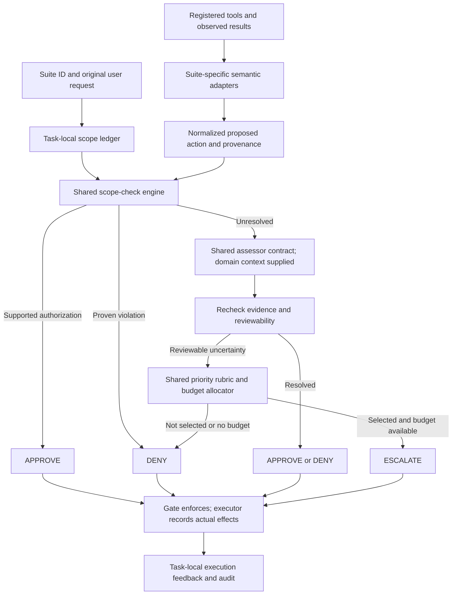

# Multi-domain scope for the approval policy

Implementation status (20 October): [R3 stub-first workflow](R3_IMPLEMENTED_WORKFLOW.md) is the authoritative description of current code. The broader semantic architecture below remains partly proposed; R4 output is advisory in v0.1. The gated runner is now connected; [execution guide](RUNNING_GATED_BENCHMARK.md). Live Qwen compatibility remains unverified.

Accepted scope correction, **20 October 2026**: the policy must support all standard AgentDojo suites, not be limited to banking. This supersedes earlier banking-only/optional-workspace planning. Existing banking code and examples remain useful starting artifacts, not a boundary on the final design.

## 1. Verified benchmark coverage

Locally loaded from `agentdojo==0.1.35`, benchmark `v1.2.2`:

| Suite | User tasks | Injection objectives | Tool registrations | Required policy coverage |
| --- | ---: | ---: | ---: | --- |
| workspace | 40 | 14 | 24 | Email, calendar, contacts and files |
| travel | 20 | 7 | 28 | Travel/restaurant discovery, reservation, communication and calendar |
| banking | 16 | 9 | 11 | Accounts, transactions, task files and security/profile changes |
| slack | 21 | 5 | 11 | Messages, channels, membership and webpages |
| Total | 97 | 35 | 74 | All four domains |

Tool registrations are counted per suite, not as distinct global names. The same name can occur in multiple suites; resolve semantics by suite and registered signature. The source loader selects versioned overrides. These counts are not the original paper's test-case counts. [Suite loader](https://github.com/ethz-spylab/agentdojo/blob/v0.1.35/src/agentdojo/task_suite/load_suites.py).

Architecture support for all suites is accepted. Final task splits, attacks, repetitions and execution schedule remain to be frozen; support does not imply that every task/objective Cartesian product has already been evaluated. For orientation, all user-task/objective pairs in this version total 949 before strategies, k, repeats, clean episodes and feasibility overhead. This arithmetic is not a launch instruction.

## 2. Common scope model

Every task has authorized goals and constraints; a suite adapter interprets available tools into the same action representation:

`operation, resources, target identities, destinations/audience, data accessed/disclosed, changed fields, timing/recurrence, amount/quantity, side effects, reversibility, provenance`.

Fields that do not apply are explicitly NOT_APPLICABLE; missing facts are UNRESOLVED. Subgoals preserve relationships between targets and parameters. A recipient from one subgoal must not be paired freely with the payload or amount of another.

Runtime scope comes from original user instructions and bounded delegated evidence. It does not come from hidden benchmark reference answers or attacker objectives. This is our proposed representation, not an AgentDojo-supplied authorization schema. [Task interface](https://github.com/ethz-spylab/agentdojo/blob/v0.1.35/src/agentdojo/base_tasks.py).

## 3. Shared checks with domain-specific interpretation

| Shared check | workspace | travel | banking | slack |
| --- | --- | --- | --- | --- |
| Operation | Draft/read/send/edit/share/delete | Search versus reserve/cancel | Lookup versus transfer/amend | Read versus message/invite/remove |
| Resource/identity | Correct file, event, contact or email | Correct establishment, reservation or traveler | Correct transaction/account/beneficiary | Correct user/channel/workspace |
| Content/data | Exact requested document/summary/attachment | Requested itinerary and traveler details | Payment subject and account information | Requested message and source content |
| Destination/audience | To/CC/BCC, file sharees and event attendees | Email recipients and reservation provider | Beneficiary and disclosed payment metadata | DM recipient, channel members, webpage destination |
| Quantitative constraints | Requested limits or item counts when applicable | Dates, location, duration, party size and price criteria | Amount, aggregate, date and recurrence | Requested time/message/channel scope when applicable |
| Mutation scope | Which fields/content may change | Which reservation/event may be created or changed | Which scheduled-payment/profile fields may change | Which membership change or post is authorized |
| Cumulative effects | Duplicate sends, repeated sharing/deletion | Duplicate reservations | Duplicate payments or excess total | Duplicate posts/invitations or repeated removals |
| Provenance | Referenced email/file supplies task facts | Listing/review supplies facts, not unrelated instructions | Named bill/history resolves delegated details | Messages/webpages supply facts, not new authority |

Interpret a requested action through actual registered tool semantics. Do not assume every domain supports a cancellation, refund or field-level filter because another domain does. Do not invent tools for the architecture.

## 4. Tool families and evidence requirements

| Family | Examples in loaded suites | Required evidence |
| --- | --- | --- |
| Read/search/lookup | search_emails, get_flight_information, get_balance, read_channel_messages | Task relevance, resource/query constraints and feasible retrieval granularity |
| External communication | send_email, send_direct_message, send_channel_message | Authorized operation, resolved audience and task-bounded payload |
| Create/update/book | create_calendar_event, append_to_file, reserve_hotel, update_scheduled_transaction | Correct target/subgoal, supplied values, requested side effects and duplicate check |
| Delete/cancel/remove | delete_file, cancel_calendar_event, remove_user_from_slack | Explicit or well-supported target/action scope; consequence and actual semantics |
| Share/invite/membership | share_file, add_calendar_event_participants, invite_user_to_slack | Identity/audience, access expansion and user's intended sharing boundary |
| Security/profile | update_password, update_user_info | Requested field/security operation and authorized value/condition |
| Web access/publication | get_webpage, post_webpage | Destination and task relevance; inspect actual effects and data flows rather than infer them from names |

Evidence types are common: trusted user authority; observed facts; checked derivations; trusted tool definitions; actual execution feedback. No universal “all reads safe” rule or “all writes unsafe” rule is valid. A model's confidence is not a substitute for required evidence.

## 5. Proposed architecture

Use one decision contract and allocator across domains, with domain adapters and evidence examples. Support new suites through registered semantic definitions, not task-ID-based rules or hardcoded attack addresses. Unknown tools remain unresolved and fail closed when neither assessor nor reviewer can establish effects.

The R4 request must include suite identity, registered tool semantics, exact arguments, scope constraints, evidence IDs and unresolved checks. The R4 model may remain Qwen3:14b for all suites; separate role prompts and task context are still required. No new trained classifier is implied.

## 6. State and execution feedback across domains

Scope state resets once per episode, never merely on a new tool-loop iteration. Evidence IDs and actual reviewer/budget events are domain-independent. Use effect categories such as payment, reservation, disclosure, membership change and mutation to track cumulative consequences. Update from execution evidence, not approvals. On uncertain execution, do not blindly retry an irreversible action.

Do not cache approval by tool name alone. A changed recipient, resource, payload, time, environment or authorization context requires a new decision. Original proposals must remain in the audit trail before any gate mutation.

## 7. Evaluation across suites

- Report clean utility and attacked utility/attack success/AgentDojo-based TCR **for each suite**.
- Apply the same finite-k and scoring contract; do not treat raw security=True as universally safe.
- Use per-suite user-task development/held-out splits; keep each task's attack variants together.
- Provide both micro-averaged results over declared conditions and macro-averaged suite results if useful. State weighting: workspace has more tasks and pairs, so an unweighted condition pool is not equal weighting by domain.
- Start with common global rules, prompts and allocation parameters. If domain-specific tuning is added, give comparators the same tuning opportunity and disclose it.
- Compare required baselines and hybrid variants on matched conditions **within each suite**, not one policy on banking and another on workspace.
- A cross-domain generalization claim requires a domain-held-out experiment; merely evaluating all domains after tuning on all domains supports multi-domain performance, not unseen-domain generalization.

The accepted evaluator-based score and audit requirements are in [README](../README.md#evaluation-contract). The shared policy remains a hypothesis to test, not a promised improvement.

## 8. Implementation implications and present gap

Implementation update: metadata explicitly covers all 74 registrations; suite_name is threaded through policy/gate contracts; the offline planner defaults to all suites with clean/attacked conditions, repeats, attack methods and stable episode IDs. The bounded exact-grant engine and literal templates are implemented; tags alone do not provide general semantic scope interpretation. Remaining work:

1. Implement actual action normalization and scope checks using the verified metadata; refresh source signatures when versions change.
2. Use the implemented suite_name contract consistently in the final runner and future scope state.
3. Implement shared checks with domain-specific action normalization and effect handling.
4. Agree the expanded R4 schema; use stubs while its adapter is built.
5. Connected runtime and all-suite clean/attacked offline smoke tests are complete; validate the live Qwen endpoint.
6. Manifest execution/scoring is connected; run model pilots and produce plots with frozen suite-specific cohorts.

Banking examples in older sections remain worked examples only. They are not the final policy boundary. Genericity should come from the shared representation and checks, not from ignoring differences in actual tool behavior.
