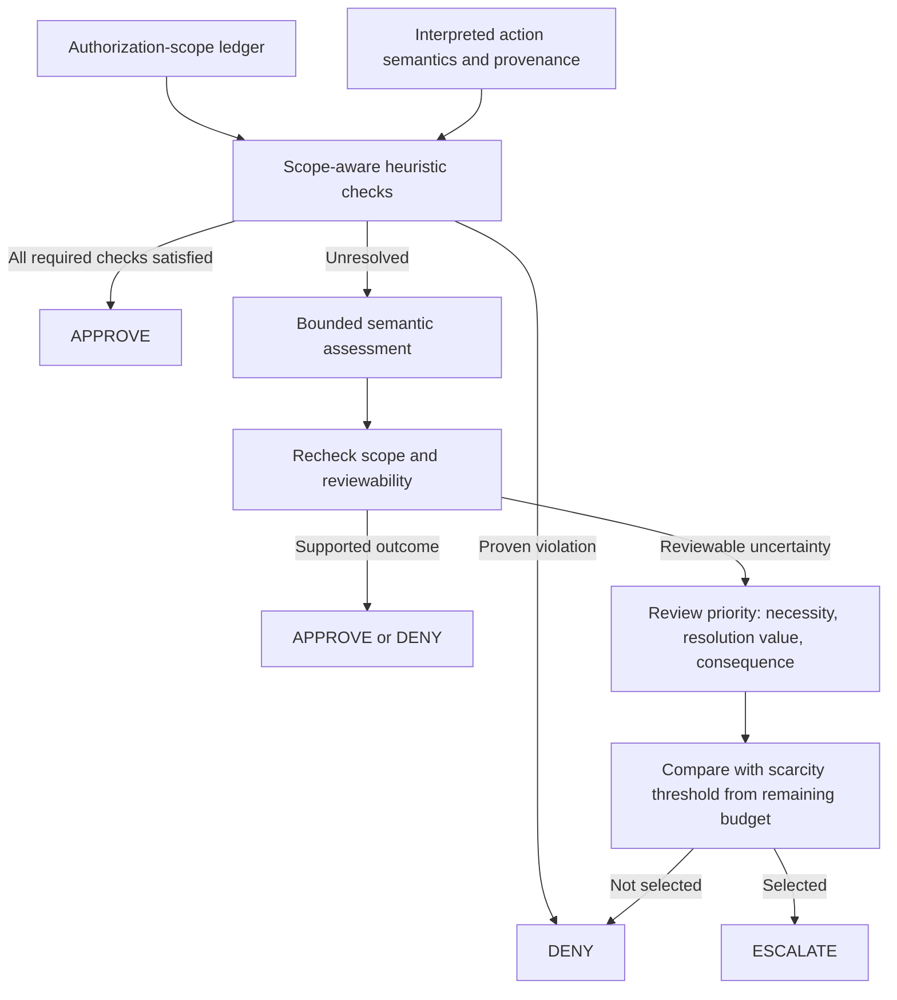

# Policy implementation types and a proposed Role 3 architecture

Current implementation update (21 October 2026): live `hybrid_llm` and `hybrid_llm_fixed` use decision-effective R4 review selection and conflict denial, version `r3-r4-review-selection-v1`. They never create grants or bypass deterministic checks/review budgets. Advisory descriptions below apply to the stub ablation or historical stage. See [the combined-policy specification](../docs/R3_R4_POLICY.md) and [current banking guide](../docs/BANKING_EVALUATION_GUIDE.md); rerun pilots in fresh directories.

Implementation status (20 October): [R3 stub-first workflow](R3_IMPLEMENTED_WORKFLOW.md) is the authoritative description of current code. The broader semantic architecture below remains partly proposed; R4 output is advisory in v0.1. The gated runner is now connected; [execution guide](RUNNING_GATED_BENCHMARK.md). Live Qwen compatibility remains unverified.

Researched **19 October 2026**. Supplement to [Industry agent approval research](INDUSTRY_AGENT_APPROVAL_RESEARCH.md). This document proposes a design; it implements no code. Updated evaluation/scope contract: [current evaluation contract](../README.md#evaluation-contract); all four AgentDojo suites are in policy-design scope, and official outcomes plus execution audit trails suffice under the user’s clarification. Public-source support is distinguished from unknown implementation details. Opened source files on `main` are moving references, not a pinned snapshot of every deployed client.

## 1. These categories overlap

A policy maps available context and a proposed action to a decision. Its **written specification**, **decision mechanism**, and **training method** are separate questions.

| Category | How it is written or implemented | Does this require new training? |
| --- | --- | --- |
| Rule-based | Explicit conditions and outcomes in code, configuration, or a decision table | No |
| Classifier-based | A component predicts a class, such as allow/block or risk category | Not necessarily: it could be a prompted LLM or a trained small model |
| LLM-based | An LLM interprets instructions/evidence and produces a decision or assessment | Not necessarily: a fixed pretrained model can follow a policy prompt |
| Learned approval policy | Approval behavior/parameters are fitted from data or rewards | Yes, for the part claimed to be learned; identify the data and learning method |
| Hybrid | Combines rules with model assessment and enforcement | Depends on its model components |

These are working definitions for our comparison. Calling a model “trained” because all LLMs undergo pretraining does not establish that a particular approval policy was learned from approval labels. Prompt tuning on a development set is also different from updating model weights.

**Recommendation:** Describe our initial method as a **rule-based policy with LLM semantic assessment and a hand-designed budget allocation rule**. It is hybrid and uses an LLM as a classifier. It is not a newly trained or reinforcement-learned approval policy.

## 2. What is actually public for each system?

“Unknown” below means not established by the inspected sources. It is not a claim that the information can never be obtained.

| Product/component | Supported classification | How the policy is expressed | Unknown / not established | Verified starting point |
| --- | --- | --- | --- | --- |
| Codex Guardian / Auto-review | Hybrid: configured boundaries plus LLM reviewer | Public natural-language template separates risk, authorization, evidence handling and outcome; separate environment/security policy text | Exact deployed prompt/version for each account; approval-specific weight training, datasets and objective | [Guardian template][gtemplate], [policy text][gpolicy], [Auto-review docs][autoreview] |
| Claude Code Auto mode | Hybrid: allowances plus LLM-based classifier | Fixed prompt template with environment, blocking and exception sections; staged classification | Complete current production template/weights and approval-specific training recipe not established | [Engineering description][anthropic], [permission modes][claudemodes] |
| VS Code Copilot Assisted permissions | LLM-based assessment within permission controls | Documentation describes an experimental judge and fallback to user confirmation | Exact judge prompt, model identity, fine-tuning, labels and complete deployed decision procedure | [Approval documentation][vscode] |
| Copilot cloud agent | Deterministic access/containment controls documented; complete semantic approval policy **unknown** | Repository/branch, workflow approval and network controls | Whether every cloud tool call uses a separate semantic classifier; its policy/training | [Application card][copilot] |
| Gemini CLI policy engine | Rule-based policy component | TOML rules and TypeScript types; allow/deny/ask decisions, argument patterns and priorities | Classification/training of any separate safety-checker service is not established by the rule schema | [Policy documentation][geminidocs], [types][geminitypes], [engine directory][geminicode] |
| Chrome User Alignment Critic | Model-based action-alignment classifier; surrounding deterministic origin controls | Company describes a separate action checker and relevant-origin restrictions | Exact model architecture, prompt, weights, training set and learning method | [Google architecture report][chrome] |
| CaMeL research prototype | Hybrid: LLM program generation plus deterministic capability/data-flow enforcement | Explicit security policies enforced by a custom interpreter | Not evidence of a deployed Google product; not evidence of a learned finite-budget allocator | [Paper v2][camel], [official artifact][camelcode] |

These classifications apply to the named **components**, not whole companies. No inspected source establishes that any of these products trains the same fixed-$k$ review-allocation policy proposed in our project.

## 3. How the most useful reference policies are written

### 3.1 Codex: policy specification in natural language

The opened Guardian template defines evidence treatment, separate authorization and risk categories, investigation guidance, and outcome rules. It contains slots for environment-specific and additional policy. The accompanying policy file spells out categories such as sensitive egress and credential probing, including payload/destination authorization. These are public **LLM instructions**, not proof that each sentence is enforced as a deterministic program. [Guardian template][gtemplate] [Security policy][gpolicy]

For inspection, start at `codex-rs/prompts/templates/guardian/policy_template.md` and `policy.md` in the official repository. Confirm the release and rendered effective policy before making deployment claims. Training details remain **unknown from these files**.

**Borrow:** separate risk from authorization and state what evidence can establish each. **Adapt:** the course objective counts any unauthorized executed call; do not copy another product's permissive risk thresholds without reconciling that objective.

### 3.2 Anthropic: classifier policy is a prompt, not necessarily a separately trained classifier

Anthropic's engineering article explicitly describes a fixed classifier prompt with customizable environment, blocking and exception sections. It describes a fast screen followed by reasoning on flagged actions. Thus “classifier” here includes LLM prompting; it does not establish a new approval model trained from scratch. The article provides `claude auto-mode defaults` as a way to inspect defaults. That command was **not run here**; availability depends on the installed version. [Engineering article][anthropic]

**Borrow:** express trust boundaries, prohibitions and narrow exceptions separately. **Do not copy:** a blanket read allowance or in-project edit allowance as proof of authorization in AgentDojo.

### 3.3 Gemini CLI: rules as structured configuration

The opened TypeScript schema exposes three policy decisions and fields for tool identity, argument matching, metadata, priority and mode. It also supports safety-checker configuration; this alone does not reveal how a checker makes its decision. The official directory lists engine, TOML loader, shipped policies and tests. These are concrete places to inspect matching/enforcement rather than guessing from a UI label. [Types][geminitypes] [Source directory][geminicode]

**Borrow:** versioned, inspectable rule configuration and explicit precedence. Keep tool metadata from trusted project annotations, rather than accepting a third-party tool's self-declared “safe” hint without verification.

### 3.4 What remains unknown, and where to look next

| Missing detail | Useful investigation path | Evidence standard |
| --- | --- | --- |
| Copilot Assisted judge prompt/model | Official VS Code source history and release notes linked from its documentation; relevant SDK/client repositories if published | A source file or maintainer documentation matching the client/version, not a third-party prompt dump |
| Claude complete classifier defaults | Inspect the documented defaults command locally, then compare with permission-mode docs | Save version and output; do not infer weights or training data from a prompt |
| Guardian effective deployed policy | Public template plus release/configuration and model-catalog selection | Distinguish repository fallback text from actual rendered policy |
| Chrome critic learning method | Google technical papers, system/model cards or architecture updates | Model description or explicit training disclosure; “AI model” alone is insufficient |
| Any claimed learned approval policy | Training paper, data/model card or released trainer | Identify learned component, labels/rewards, loss/objective and held-out evaluation |

These are **potential follow-up sources**, not already verified disclosures. Avoid treating issue reports, unofficial mirrors or extracted prompts as authoritative product specifications.

## 4. Proposed architecture for our policy

The detailed internal policy design is now in [Scope-aware policy architecture](SCOPE_AWARE_POLICY_ARCHITECTURE.md). It replaces the earlier team-integration diagram with five policy components:

The linked specification defines the ledger, four-state checks, rule precedence, reviewability filter, priority formula, scarcity threshold, worked trajectory, failure modes and experimental justification. All are proposals, not measured improvements or replicas of a vendor's private implementation.

## 5. The comparison that makes this defensible

Evaluate full approve, finite-budget full escalate, hybrid with fixed allocation, and hybrid with budget-aware allocation across workspace, travel, banking and Slack using matched per-suite conditions. Hold the rules, judge, reviewer and runtime constant between hybrid variants. Give both allocation variants comparable development tuning effort; freeze before held-out evaluation.

Measure AgentDojo-based task completion without specified attack success, attack-success rate, clean/attacked utility, review load, component costs, latency, failures with unused budget and exhaustion denials. Do not map raw security=True to safe: it means attack success on attacked conditions and is a sentinel on clean runs. Log executed calls for audits; separate independently identified extra violations from official benchmark metrics. A fixed budget does not itself make a policy budget-aware: the decisions must depend on available budget beyond the gate's mandatory exhaustion rule.

Our claim should be: **we test whether a transparent hybrid policy allocates a limited review budget effectively**. Whether it improves outcomes remains an experimental question.

## 6. Verified primary references

All opened 19 October 2026. Links to source `main` can move; pin exact revisions when implementing. Published text describes components but does not disclose every training detail.

- [OpenAI official Guardian template][gtemplate] and [environment/security policy][gpolicy]: actual public natural-language policy files.
- [OpenAI Auto-review documentation][autoreview]: integration scope and reviewer lifecycle.
- [Anthropic Auto mode engineering article][anthropic]: prompt structure and staged classification.
- [Claude Code permission modes][claudemodes]: current configuration and behavior.
- [VS Code approval documentation][vscode]: experimental judge-assisted permissions; no training recipe established.
- [GitHub application card][copilot]: cloud-agent controls; not a complete public semantic approval policy.
- [Gemini policy documentation][geminidocs], [TypeScript types][geminitypes] and [policy source directory][geminicode]: rule representation and locations to inspect enforcement.
- [Google Chrome architecture report][chrome]: alignment critic and origin controls.
- [CaMeL paper v2][camel] and [official research artifact][camelcode]: explicit enforcement research and non-product caveat.

[gtemplate]: https://github.com/openai/codex/blob/main/codex-rs/prompts/templates/guardian/policy_template.md
[gpolicy]: https://github.com/openai/codex/blob/main/codex-rs/prompts/templates/guardian/policy.md
[autoreview]: https://learn.chatgpt.com/docs/sandboxing/auto-review
[anthropic]: https://www.anthropic.com/engineering/claude-code-auto-mode
[claudemodes]: https://code.claude.com/docs/en/permission-modes
[vscode]: https://code.visualstudio.com/docs/agents/run/approvals
[copilot]: https://docs.github.com/en/copilot/responsible-use/agents
[geminidocs]: https://geminicli.com/docs/reference/policy-engine/
[geminitypes]: https://github.com/google-gemini/gemini-cli/blob/main/packages/core/src/policy/types.ts
[geminicode]: https://github.com/google-gemini/gemini-cli/tree/main/packages/core/src/policy
[chrome]: https://blog.google/security/architecting-security-for-agentic/
[camel]: https://arxiv.org/html/2503.18813v2
[camelcode]: https://github.com/google-research/camel-prompt-injection
