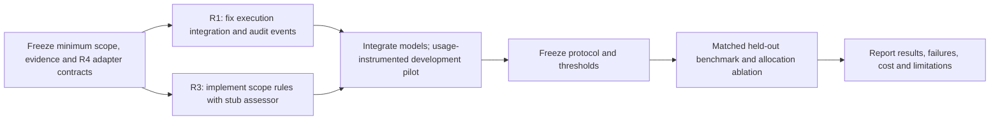

# Project decision register

Reconciled **20 October 2026**. This replaces the earlier long recommendation list, which contained stale workspace defaults, unresolved scope statements and an unnecessary independent-labeling prerequisite. Entries below distinguish accepted direction, code defaults and genuine open decisions.

## 1. Source precedence and document map

- Course handout: required AgentDojo gate, original three-way policy, full-approve/full-escalate baselines, online LLM reviewer, finite per-task k, report evidence and presentation.
- User clarification: five-page report; all-suite policy scope (latest correction supersedes earlier banking-only direction); audit recommendations accepted; **AgentDojo results suffice for evaluation with executed-call audit trails**. These are user-supplied clarifications, not independently obtained TA messages.
- [AgentDojo learning and evaluation](../README.md#evaluation-contract): verified benchmark semantics and scoring contract.
- [Policy architecture](SCOPE_AWARE_POLICY_ARCHITECTURE.md): detailed proposed policy internals.
- [Role 3 work plan](ROLE_3_RESEARCH_PLAN.md): implementation scope and checkpoints.
- [Industry review](INDUSTRY_AGENT_APPROVAL_RESEARCH.md) and [policy types](POLICY_TYPES_AND_PROPOSED_ARCHITECTURE.md): sourced inspirations, not our runtime specification.
- Older HTML/PDF plan exports are not synchronized specifications. Regenerate them from reviewed Markdown if needed; their content may be stale.

## 2. Accepted decisions

| Topic | Accepted direction / qualification |
| --- | --- |
| Benchmark/policy scope | All four suites: workspace, travel, banking and Slack; package 0.1.35 / benchmark v1.2.2. Existing banking implementation is a starting artifact, not final scope. See [multi-domain specification](MULTI_DOMAIN_POLICY_SCOPE.md). |
| Policy | Scope-aware heuristics with semantic assessment and selective, budget-aware review |
| Existing risk policy | Preserve `risk_based` as a simple reference; add hybrid separately |
| Interfaces | Start from existing Policy.decide(GateInput) -> GateOutput; extend compatibly |
| Budget | Gate is authoritative; actual review consumes one slot; exhaustion denies calls requiring review |
| Scope | Interpret original task and observable evidence; do not use benchmark labels as runtime authorization |
| Delegated details | Permit task-authorized lookup/file-derived facts; broad file instructions need bounded interpretation, not a blanket ban |
| Evaluation | Official AgentDojo utility and attack-goal outcomes plus mandatory execution audit trail |
| Headline metric | AgentDojo-based TCR on attacked conditions: task completion AND failure of the specified attack objective |
| Clean tasks | Report clean utility separately; raw security=True is not a clean-run safety certificate |
| Main comparisons | Full approve, finite-k full escalate, customized policy |
| Budget contribution | Compare identical hybrid variants with fixed versus budget-dependent allocation |
| Training | No new model training required; fixed LLM assessment plus explicit rules is the initial design |
| Provisional model assignment, 20 October | User prefers Qwen3:14b for agent, R4 assessor and reviewer. Use separate prompts/contexts; shared-model errors may be correlated. Gemini remains a fallback, not a required comparison. Confirm live compatibility and record the exact Ollama model/version before final freeze. |
| Resources, user clarification 20 October | Qwen3:14b and Gemini are considered free under the project access arrangement; no project spending/runtime cap requested. Provider quotas and operational episode/retry limits remain separate. |
| Submission | Five-page report, GitHub evidence, 10-minute presentation + 5-minute Q&A |

Improvement is a hypothesis. Higher benchmark TCR at matched k supports the whole-policy claim; the fixed-versus-dynamic ablation supports a budget-allocation claim. Comparable performance with less review/cost is an efficiency finding, subject to variability. Negative results must remain reportable.

## 3. Established code defaults, not frozen final experimental choices

| Existing default | Evidence / implication |
| --- | --- |
| Four suites, 97 user tasks and 74 suite-tool registrations | Suite-aware metadata covers the registered inventory; semantic check tags still require executable scope rules |
| k in {0,1,3,5} | Planner default; use for development before freezing final range |
| qwen3:14b via Ollama | Team agent factory/reviewer default; live compatibility not established by this review |
| Gemini adapter at repository root | Separate stock-pipeline runner; defaults to workspace and does not activate team gate |
| 12,552 default pending rows | Multi-suite planner includes clean/attacked conditions, attack method, repeat and unique episode IDs. Legacy banking CSV preserved. Explicit hybrid_stub labels are registered; defaults remain the three reference policies. |
| Gate policy output | Optional audit payload now carries checks, assessor status/result, priority and proposal hash for the R3 core; legacy policies remain compatible |
| R5 logger/metrics/cost modules | Standalone implementation; integration and scorer mapping pending |

## 4. Contracts for integrated policy implementation

R3 v0.1 implements a conservative local contract and stub-first core. [Workflow](R3_IMPLEMENTED_WORKFLOW.md) and [R4 handoff](R4_INTEGRATION.md) specify exact current behavior. Host wiring is implemented; remaining team alignment concerns later semantic scope validation, rather than requiring a final R4 model before R3 coding.

| Decision | Concrete proposal | Still needs agreement |
| --- | --- | --- |
| R4 assessment contract | Return per-check status, evidence IDs, unresolved question, consequence and error status | Adoption of the supplied v0.1 schema; provider timeout/retry/model settings and later semantic scope validation |
| Policy lifecycle | Episode-local scope ledger and execution history, reset once per task | Wired in GatedAgentPipeline; validate live model behavior |
| Evidence identifiers | Stable instruction/observation/call IDs, trust tags and original proposed arguments | Fields shared by gate, judge and logger |
| Multi-domain scope rubric | Shared operation/resource/audience/data/constraint/provenance checks with suite-specific semantics; metadata inventory is implemented | Executable adapters and per-action evidence requirements; delegated instructions, implicit supporting steps and unresolved identity |
| Scope construction | R3 owns the ledger; literal extraction first, semantic extraction through the R4 adapter with validated source citations | Minimal extraction schema and ownership of candidate-constraint validation; omitted constraints must not imply unrestricted authority |
| Approval criteria | Four-state checks; proven violation denies, supported checks approve, unresolved routes onward | Which checks are required for each action class and what evidence suffices |
| Review priority | Necessity, resolution value and consequence; scarcity affects review only | Freeze rubric definitions before pilot; numeric weights afterward |

Shared deterministic exact-grant checks, literal templates and registered suite validators now run with a stub assessor. R4 outputs remain advisory until candidate-scope validation is designed. No independent per-call authorization dataset is required before implementation under the user's evaluation clarification.

## 5. Decisions needed before live pilot / final evaluation

- Validate the provisional Qwen3:14b-only pilot for agent, semantic assessor and reviewer; record Ollama/model versions and role-specific settings. A Gemini model ID is needed only if the fallback is used. The user’s “probably” is a provisional preference, not a frozen experimental configuration.
- Pilot size and operational episode/retry limits. The user specified no project spending/runtime cap; do not invent a monetary cap. Record usage and provider quota failures even when no API charges are expected.
- Development/held-out user-task IDs, attack methods/objectives/configurations, attack-generation protocol and clean coverage.
- Final k values, repetition count, valid-run retry policy, episode bounds and exclusions.
- Final thresholds selected on development data; equally tune the fixed-threshold comparator.
- Aggregation: separate clean and attacked panels recommended; define repetitions/task weighting and error/missing bounds.
- Report counting rules: whether references/appendices count in five pages; official deadline/template and speaker rules remain unconfirmed.

Independent strict authorization scoring is optional supplementary analysis, not an unresolved barrier. If audit finds behavior beyond the official attack objective, retain the benchmark result and describe the additional finding separately.

## 6. Engineering corrections already identified

These are implementation defects/gaps, not choices to defer:

1. Support actual AgentDojo FunctionCall objects, not dict-only fixtures.
2. Supply the original task to the policy; isolate runtime data from evaluator-only fields.
3. Add a repeated tool-use loop with gate interception on every iteration.
4. Preserve all proposed calls/results in mixed approved/denied batches; append denials without causing approved calls to be skipped.
5. Preserve original trajectory/calls before mutation; add episode/call IDs and actual execution/reviewer events.
6. Reconcile metrics with the accepted AgentDojo-based mapping, condition-aware raw security semantics, cohort totals and fixed denominators. Do not deduplicate repeated episodes by task ID alone.
7. Stale test imports are repaired. Reviewer-error, budget, mixed-batch and denial behavior now passes connected integration tests.
8. Validate sensitive execution semantics, including amendment fields that the upstream tool may ignore for false/zero values; do not silently patch benchmark behavior mid-comparison.

Earlier metadata/planner validation: 11 new unittest tests passed and 41 legacy checks passed by direct offline invocation after repairing stale imports and the shared-request fixture. This is not a pytest or live end-to-end benchmark run; those earlier integration blockers are now addressed by the connected factory; live Qwen compatibility remains unverified.

**Reviewer prompt correction implemented:** task-authorized lookup-derived recipients are permitted when evidence supports them; literal absence from the user prompt alone no longer forces denial. This is a prompt/design correction, not evidence that every file-derived beneficiary is genuine. See the [implementation/baseline runbook](ROLE_3_IMPLEMENTATION_AND_BASELINE_RUNBOOK.md).

## 7. Readiness sequence

All-suite support is required design scope. Optional studies after core readiness include domain-held-out generalization, assessor-context ablation, additional models and stricter independent authorization audits. Do not displace required baselines or audit logging with optional scope.

## 8. Implemented R3 v0.1 handoff

New labels `hybrid_stub` and `hybrid_stub_fixed` expose the core without changing default experiment workload. No arbitrary natural-language permission extraction, live assessor, model benchmark improvement result is implied. Gated execution is now connected separately. The runnable demo, schemas and comparison commands are linked in [the implemented workflow](R3_IMPLEMENTED_WORKFLOW.md). Use `src.r3_compare` for the new normalized-result comparison contract; the older R5 metrics module is not silently replaced.

Validation for the new core: 26 scope/lifecycle/assessor tests, 4 comparison tests and 11 metadata/planner tests passed offline. The HTML contains generated demo data; browser visual QA is unverified because the preview tool blocks local file URLs.

Additional regression verification for this implementation: 31 legacy zero-argument checks passed by direct offline invocation with socket connections blocked. This is not a full pytest suite or live AgentDojo run.

## 9. Connected execution status

`src.run_experiments` executes selected manifest rows through the shared gated runtime and official evaluator, with durable traces, reviewer/agent usage and resume between episodes. R4 remains a stub. Verification: 15 dedicated integration tests and 40 all-suite clean/attacked scripted smoke episodes passed. Ollama was unreachable, so no live Qwen benchmark result is claimed. [Commands and output contract](RUNNING_GATED_BENCHMARK.md).
