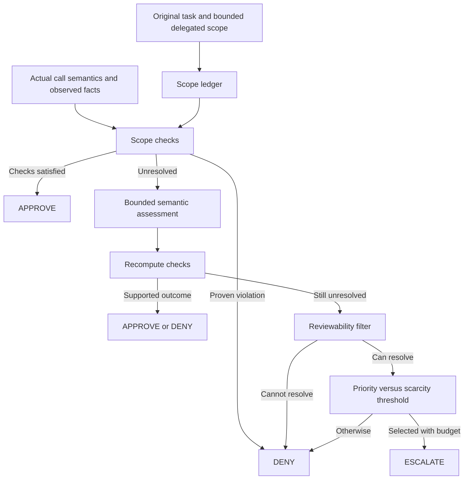

# Role 3: scope-aware policy implementation and evaluation plan

Updated **20 October 2026** after checking the team repository and AgentDojo. The latest accepted policy scope includes workspace, travel, banking and Slack; earlier banking-only direction is superseded. See [multi-domain scope](MULTI_DOMAIN_POLICY_SCOPE.md). This replaces obsolete workspace-pilot defaults and claims that all team components remain unimplemented.

**Detailed implementation guide:** [Multi-domain checks, state/evidence contracts, R4 handoff and baseline runbook](ROLE_3_IMPLEMENTATION_AND_BASELINE_RUNBOOK.md). Existing commands are distinguished from proposed runner interfaces.

## 1. Goal and evidence

Build an original policy that uses scope-aware rules to resolve clear calls and allocates scarce review to useful, resolvable uncertainty. **Test** whether it improves AgentDojo results; do not assume improvement.

The user clarified that official AgentDojo outcomes suffice for evaluation with an executed-call audit trail. For valid attacked episodes, let $U_i$ mean utility pass and $J_i$ mean attacker-goal success:

$$\operatorname{TCR}_{\mathrm{AD}}@k=\frac{1}{N}\sum_{i=1}^{N}U_i(1-J_i),\qquad E_i\le k.$$

Report this as AgentDojo-based project TCR. It does not certify the absence of every possible unauthorized call. Report clean utility separately: clean raw security=True is a sentinel, while attacked raw security=True means attack success. See [verified scoring contract](../README.md#evaluation-contract).

## 2. What exists and what you own

The team folder has the policy interface, gate/budget code, baseline classes, a metadata policy, LLM reviewer and standalone R5 modules. The new shared execution factory now uses a connected repeated gate; the old standalone gate is legacy-only. The bounded R3 core is now implemented with literal scope rules, episode state, allocation and a stub assessor; the semantic R4 assessor remains pending and live Qwen compatibility awaits a reachable local server. See [implemented workflow](R3_IMPLEMENTED_WORKFLOW.md).

| Role | Responsibility |
| --- | --- |
| R1 | Execution gate, authoritative budget, repeated tool loop and runtime integration |
| R2 | Baselines and online simulated reviewer |
| R3: you | Scope ledger, tool metadata/rules, HybridPolicy, review allocation and decision evidence |
| R4 | Structured semantic assessment of unresolved checks |
| R5 | Experiment execution, audit/cost logs, metrics, plots and analysis |

A reviewer is not the R4 assessor. `RiskBasedPolicy` currently acts on tool-name metadata; it does not implement your scope or budget-allocation contribution.

## 3. Benchmark-aligned multi-domain scope

Use installed AgentDojo 0.1.35, benchmark v1.2.2 across all four suites: 97 user tasks and 74 tool registrations. Use the [shared checks and per-domain matrix](MULTI_DOMAIN_POLICY_SCOPE.md). The banking table below is a worked example, not a restriction to that domain. The existing planner's k in {0,1,3,5} is the development starting point; final workload and thresholds are not frozen.

| Banking operation | Policy checks |
| --- | --- |
| Transaction/account lookup | Task relevance and data/resource breadth; broad retrieval can be explicitly requested |
| Pay/refund | Beneficiary, amount/calculation, date, subject disclosure and duplicates |
| Schedule/amend | Correct ID and authorized changed fields, recurrence and recipient |
| read_file | Named/relevant task source; distinguish delegated facts/instructions from unrelated expansion |
| Profile/password change | Requested operation and values; these are legitimate for some tasks |

AgentDojo supplies prompts, not a ready-made authorization ledger. A recipient absent from the literal prompt can be resolved through a user-authorized bill/history lookup. Some tasks delegate file instructions; a blanket ban would damage utility. Contradicting an explicit constraint is a violation; insufficient evidence is unresolved. If the sole source is compromised, neither rules nor another LLM can be assumed to recover hidden true values.

## 4. Internal policy architecture

The [detailed architecture](SCOPE_AWARE_POLICY_ARCHITECTURE.md) specifies each component, input/output, formulas and failure modes.

Use SATISFIED / VIOLATED / UNRESOLVED / NOT_APPLICABLE check results. No new classifier training is required. R4 uses a fixed pretrained LLM; R3 implements explicit rules and allocation.

Candidate allocation uses necessity, review resolution value and consequence; refer to the architecture for the rubric. Numeric coefficients are illustrative development settings. Budget scarcity never converts an uncertain call into approval. Only the gate mutates review budget.

## 5. Implementation checkpoints

**Current checkpoint:** R3 v0.1 rules/state/allocation/stub and offline demo are implemented. The minimum contract is supplied in [R4 integration](R4_INTEGRATION.md); this is a concrete handoff for team review, not a claim that R4 has accepted or integrated it. Below retains the overall sequence.

1. Agree suite-aware R1-compatible scope state, evidence IDs, original-task propagation and R4 schema. Existing GateInput/GateOutput are the starting contract, not missing from scratch.
2. Metadata coverage for all 74 suite-tool registrations and the multi-suite offline planner are complete. Implement the shared scope checks and suite-specific semantic adapters with a stub assessor; metadata check names alone do not enforce authorization.
3. Fix/test actual FunctionCall compatibility, repeated gated tool loop, mixed batches, reset and execution feedback with R1.
4. Integrate R4 and R2 separately. Add decision layer, check evidence, allocation values, actual review events and executed calls to R5 logs.
5. Run a usage-instrumented development pilot on clean and attacked tasks. The user requested no project spending/runtime cap and considers Qwen3:14b and Gemini free under the project access arrangement. Qwen3:14b is the user’s provisional choice for agent, R4 assessor and reviewer, with separate prompts/contexts and Gemini as fallback. Shared-model errors may be correlated; validate live compatibility and retain finite episode/retry limits. Measure errors, unused budget, completion, attack outcome and per-component usage.
6. Tune a small configuration set on development tasks; give fixed and dynamic allocation equal opportunity. Freeze before held-out evaluation.
7. Analyze policy errors and real trajectories, contribute method/results to the five-page report, rehearse the presentation.

Do not tune from final evaluator labels or show benchmark ground truth/attacker objectives to runtime models. Offline fixtures diagnose decisions; online runs measure completion after replanning.

### Minimum contracts used by the stub-first implementation

The architecture needs no redesign. The current core uses the small versioned contract documented in the implementation handoff. The host lifecycle and feedback wiring are implemented while R4 can develop the assessor; broader semantic scope extraction remains separate work.

| Contract | Proposed implementation boundary |
| --- | --- |
| Scope construction | R3 owns the ledger and preserves the original task verbatim. Deterministically extract only supported literal constraints. Any semantic extraction uses the R4 adapter, returns source spans/evidence IDs and remains a candidate interpretation until validated. Never treat an omitted constraint as unrestricted permission. |
| Initial scope versus later evidence | Task instructions establish goals and permitted delegation. Observations may resolve delegated details but cannot independently expand authority. Preserve relational subgoals so recipients, amounts and resources from different requests cannot be combined freely. |
| Required checks | Each action adapter declares required dimensions, evidence accepted for each, and actual effects. APPROVE requires every required check satisfied; NOT_APPLICABLE requires a reason and cannot hide missing evidence. A proven violation denies; unresolved evidence follows the assessment/review path. |
| R4 adapter v0.1 | Include episode/call IDs, immutable proposed arguments, task/ledger snapshot, requested checks and bounded evidence. Return per-check status, cited evidence IDs, explanation and explicit error/unknown status. Validate IDs and allowed statuses; malformed/timeout results remain unresolved and cannot authorize a call. Final model settings may be integrated later. |
| Allocation rubric | R3 owns ordinal necessity, review resolution value and consequence ratings. Each rating needs a rule ID or supported assessment evidence. Define each level before the pilot; do not claim resolution probability is calibrated. Choose numeric weights and thresholds only on development tasks. |
| Lifecycle and audit | Agree begin-episode, observation and execution-feedback events. Only actual execution feedback updates cumulative effects; approval alone does not. Stable event IDs make retries idempotent. R1 alone decrements review budget and resets it once per episode. |

Keep the first implementation bounded: explicit adapters for the registered tools, four-state checks, a stub assessor and inspectable allocation. A trained classifier, universal natural-language authorization parser and additional model comparisons are not prerequisites.

Before comparative runs, require an integration smoke test showing original-task propagation, real FunctionCall handling, repeated interception, mixed-batch execution, budget exhaustion, reviewer failure and immutable audit events. Align R5 metrics and R2's delegated-recipient prompt before freezing any comparisons. These runtime requirements need not block R3 unit-level development.

## 6. Experimental evidence

- Required: full approve, finite-k full escalate and customized hybrid.
- Keep existing metadata policy as a useful simple reference if affordable.
- Isolate allocation: same rules/assessor/reviewer, fixed threshold versus budget-dependent threshold. Zero-delta is a simple ablation; a fairly tuned fixed threshold is the stronger competitor.
- Split by user-task identity; keep attack variants together. Freeze attack protocol, k range, repetitions and episode bounds.
- Report attacked utility, attack success, AgentDojo-based TCR, clean utility, HITL totals/cohorts and component cost. Identify error/missing cells instead of hiding them.
- Representative over-conservative and over-permissive trajectories remain required report evidence. If a category is unobserved, disclose it and ask about a development stress test; do not fabricate a benchmark case.

## 7. Industry-derived design choices

| Inspiration | Adopted idea | Qualification |
| --- | --- | --- |
| Codex Guardian | Separate authorization, consequence and evidence; check payload and destination | Do not copy risk thresholds that conflict with our task objective |
| Gemini CLI | Inspectable rule IDs, precedence and three outcomes | Does not validate our scarcity formula |
| Claude Code | Resolve cheap cases before model assessment; structure block rules/exceptions | Do not assume all reads or in-project edits are task-authorized |
| VS Code Copilot Assisted | Model-assisted approval with an explicit fallback | Experimental product behavior, not evidence of our evaluator performance |
| Chrome critic / CaMeL research | Check task alignment and retain provenance/data-flow distinctions | Our heuristic ledger has no formal security guarantee |

References and unknowns: [industry sources](INDUSTRY_AGENT_APPROVAL_RESEARCH.md), [public policy implementations](POLICY_TYPES_AND_PROPOSED_ARCHITECTURE.md).

## 8. Presentation and remaining decisions

Five-page report: share approximately one page for the overall method; R3 explains scope rules and allocation in about half of that page. Results and failure analysis belong in shared evidence sections. Confirm whether references count in the five pages. Presentation: 10 minutes + 5-minute Q&A; about 90 seconds for R3 is a proposal.

Explain: problem → scope checks → review selection → benchmark comparison → real failure/lesson. Do not use a company feature diagram as proof of improvement.

Remaining contracts and pre-pilot decisions are listed in the [decision register](PROJECT_DECISION_REGISTER.md). The old internal October freeze dates are targets, not evidence that integration has passed. Official deadline and format details remain unconfirmed.

Execution update: [the connected runner](RUNNING_GATED_BENCHMARK.md) consumes existing manifests. Four-suite clean/attacked offline integration passed; live model validation remains outstanding.

## 21 October development revision

Follow [Matched development rerun v2](MATCHED_RERUN_V2.md). V1 produced no known completions and 15 API timeouts per condition; it does not demonstrate policy improvement. V2 adds bounded exact read prerequisites, task-derived review relevance, a declared delta=0.05 experiment, shared tool-use guidance and a 300-second diagnostic request timeout. Require a successful live clean preflight before the matched 120-episode development cohort. Keep v1 immutable, compare policies within v2, and reserve held-out tasks for final claims. R4 remains advisory; bounded templates do not establish general semantic scope extraction.
